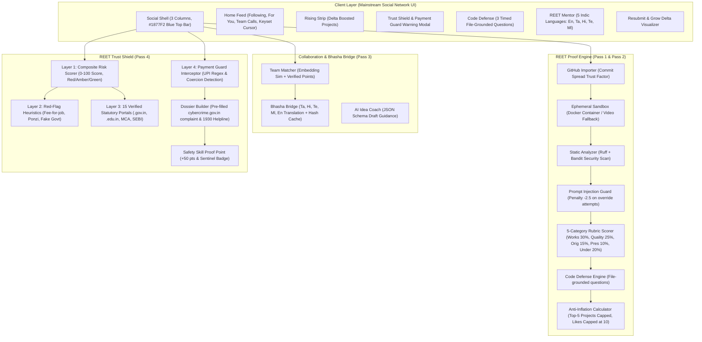

# REET (ரீட் / रीत)
> **Where projects are your profile. Prove what you build.**  
> *Formerly YuvaConnect AI — built for Indian students and builders across Tier-1, Tier-2, and Tier-3 colleges.*

---

## ⚡ Quick Start (Setup in 3 Commands)

REET is designed to run zero-dependency in offline mock mode without requiring Docker or cloud credentials.

```bash
# 1. Clone & Enter Directory
cd "AI-based-social media"

# 2. Install Dependencies
pip install fastapi uvicorn pydantic sqlalchemy aiosqlite pytest pytest-asyncio

# 3. Launch REET Full-Stack Server
python -m uvicorn apps.api.main:app --host 127.0.0.1 --port 8000
```
Open **[http://127.0.0.1:8000](http://127.0.0.1:8000)** in your browser to experience the complete platform.

---

## 🧪 Run Automated Verification & Evaluation Suite

REET includes a comprehensive automated suite of 99 test cases covering the Proof Engine, Anti-Inflation formula, 4-Factor Feed Ranker, Keyset Cursor Pagination, Code Defense, Team Matcher, and Trust Shield:

```bash
python -m pytest tests/ -v
```
**Current Test Benchmark:** `99 passed in 1.58s (100% pass rate)`

---

## 🎨 Design System & Aesthetics

REET is crafted with a mainstream social network aesthetic:
- **Primary Brand**: Facebook Blue `#1877F2`, with hover `#166FE5` and selected tint `#E7F3FF`.
- **Surfaces & Page**: Canvas `#F0F2F5`, post & rail cards `#FFFFFF`, borders `#CED0D4`, primary text `#1C1E21`, secondary `#65676B`.
- **Semantic Colors**: Green `#31A24C` (verified scores, safe), Amber `#E8A317` (warning banners, medium risk), Red `#D93025` (scam blocks, danger).
- **Desktop Layout**: 3-column desktop shell (Left Nav 240px, Center Feed 600px, Right Rail 320px) with fixed 56px white top bar.
- **Feed Ranker Invariant**: A 6/10 post with 5,000 likes **cannot** outrank an 8/10 post with 5 likes under identical recency and relevance. Verified work always trumps social attention.

---

## 🏛️ System Architecture



---

## 💡 "Why Not Just Use GitHub?"

| Dimension | GitHub | REET |
| :--- | :--- | :--- |
| **Core Incentive** | Stores code and commits | **Rewards verified understanding and real-world utility** |
| **Effort Normalization** | Star-farming, tutorial clones, and forks look identical to original work | **Normalizes effort across unequal colleges; 50 trivial scripts cannot beat 5 rigorous systems** |
| **AI Cheating Resistance** | Easily gamed with prompt-injected LLM boilerplate | **Prompt injection guard (-2.5 penalty) + 3 timed file-grounded Code Defense questions** |
| **Team Recruitment** | Resume claims and static follower counts | **Matches candidates on verified skill points and verifiable proof reasons** |
| **Regional Accessibility** | English-only interface | **Bhasha Bridge: Seamless translation across Tamil, Hindi, Telugu, Malayalam, English** |
| **Student Safety** | Zero recruitment protection | **Trust Shield: Intercepts fee-for-job scams, personal UPI solicitation, and generates 1930 dossiers** |

---

## 🎬 3.5-Minute Demonstration Walkthrough

1. **Step 1: The Feed & Signature 5-Category Breakdown (0:00 - 0:45)**
   - Open the Project Feed. Every card shows the author, verified engineer level, and verifiable score (e.g., `9.3 / 10`).
   - Click **"View 5-Category Breakdown →"**: view the 5 horizontal progress bars:
     - *Works (30%)*: Pass/fail container tests.
     - *Code Quality (25%)*: Modularity, type annotations, Bandit security checks.
     - *Originality (15%)*: Novelty check against repository corpus.
     - *Presentation (10%)*: Documentation clarity and architecture diagrams.
     - *Understanding (20%)*: Commit author history spread and Code Defense results.
2. **Step 2: Connect GitHub & Ephemeral Sandbox Evaluation (0:45 - 1:30)**
   - Click **"⚡ Import from GitHub"**. Select a hand-graded sample profile (e.g. `aarav-s/indic-voice-assistant`).
   - Check the mandatory ephemeral sandbox consent box.
   - Click **"Run REET Proof Pipeline →"**: watch commit spread verification, Bandit linter scan, prompt injection guard check, and dynamic score calculation.
3. **Step 3: Code Defense & REET Mentor (1:30 - 2:15)**
   - Click **"🛡️ Defend Code (+0.5)"**: an interactive 60-second timer starts with 3 questions grounded in the repository files (`speech_engine.py`, error recovery, persistence trade-offs).
   - Submit answers to receive supportive feedback and an Understanding score boost.
   - Click **"🧑‍🏫 Ask Mentor"**: toggle across English, தமிழ் (Tamil), हिन्दी (Hindi), తెలుగు (Telugu), and മലയാളം (Malayalam). Inspect the exact defect diagnosis, code diff, and practice task to earn +1.0 point.
4. **Step 4: The 45-Second Trust Shield Sequence (2:15 - 3:00)**
   - Switch to **"🛡️ Trust Shield"**:
     - *Step 4a (The Fake Post)*: A post reading *"Google internship, pay ₹2,000 to confirm your seat"* is automatically flagged with **Risk Score 92/100 (RED Band)** and blocked, showing 3 concrete reasons in Tamil and English.
     - *Step 4b (The Payment Moment)*: Scammer attempts to solicit payment in DM (`google.hr.recruitment@okicici`, ₹2,000). Payment Guard intercepts in real-time, displaying the high-risk warning modal with 1930 Cybercrime Helpline and "Don't send (Recommended)".
     - *Step 4c (The Cybercrime Dossier & Safety Skill)*: Click **"File Report & Earn Safety Skill"**. Generates a pre-filled complaint dossier with cryptographic evidence hash for `cybercrime.gov.in`, awarding the student **+50 Safety Skill Points** and the **Trust Shield Sentinel** badge.
     - *False-Positive Shield*: Test the genuine Google stipend (₹15,000) or SIH logistics group—verified statutory registry mitigates false alarms to stay **GREEN Band**.
5. **Step 5: Team Up & Proof Profile (3:00 - 3:30)**
   - Switch to **"🤝 Team Up"**: inspect candidate rankings for active team calls. Every candidate card features verified skill level bars and a one-line proof reason grounded in audited projects.
   - Test Bhasha Bridge multilingual messaging.
   - Switch to **"👤 Proof Profile"**: inspect the Anti-Inflation formula $\text{Level} = \lfloor\sqrt{\text{Points}/100}\rfloor + 1$, segmented skill bars (Python, Web, ML, Safety), and the immutable cryptographic audit ledger.

---

## ⚖️ Responsible AI & Statutory Transparency

- **Score Appeals & Human Review**: Every automated score includes an *"Appeal for Human Review"* option. Appealed versions are routed to a verified mentor review queue.
- **Privacy & Right to Purge**: Students maintain total ownership of their code. Code is processed in read-only ephemeral sandboxes and can be permanently removed at any time via *"Delete my project & data"*.
- **Anti-Prompt-Injection**: Evaluator prompts enforce strict system-role boundaries. Injections attempting to demand a `10/10` score incur an immediate **-2.5 penalty**.
- **No Law Enforcement Impersonation**: REET does not claim to freeze bank accounts or file police reports on a user's behalf. REET provides formatted digital evidence dossiers with SHA-256 message hashes for rapid manual lodging on `cybercrime.gov.in` or via dialing **1930**.
- **Verified Registry Snapshots**: Statutory corporate (MCA CIN) and educational (.gov.in, .edu.in) registries carry timestamped snapshots (`2026-10-23`) to ensure auditability.

---

## 🗺️ Post-Hackathon Roadmap

- [ ] **Decentralized Verifiable Credentials**: Issue W3C-compliant Verifiable Credentials (VCs) on Polygon for student Proof Profiles.
- [ ] **Live Audio Defense with Whisper + Indic TTS**: Real-time voice interview defense in local vernacular dialects.
- [ ] **IDE Plugin (VS Code / Cursor)**: In-editor telemetry and continuous commit defense directly within the developer's workspace.
- [ ] **State Cyber Police Integration**: Direct API integration with State Cyber Crime Investigation Cells for verified scam VPA blacklisting.

---
*REET · Built with craft, rigor, and restraint for the next generation of Indian engineers.*
